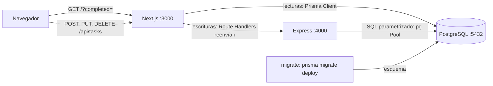

# Arquitectura

Vista de conjunto: qué piezas hay, por dónde viaja una lectura y una escritura, y dónde vive cada responsabilidad. El detalle de cada capa está en su página: [`database.md`](database.md), [`api.md`](api.md), [`frontend.md`](frontend.md) y [`docker.md`](docker.md).

## Componentes

| Componente | Carpeta | Qué hace | Qué no hace |
|---|---|---|---|
| PostgreSQL 18 | `docker-compose.yml` (servicio `db`) | Guarda la tabla `tasks` y rellena `id`, `completed` y `created_at` con sus valores por defecto. | — |
| Schema y migraciones | `backend/prisma/` | Definen la tabla, una sola vez. | Nadie cambia la tabla a mano. |
| `migrate` | `docker-compose.yml` | Aplica las migraciones pendientes y termina; la API espera a que acabe. | No crea migraciones. |
| API (Express) | `backend/src/` | Valida cada petición y es **la única que escribe**. Formato de error único. | No usa Prisma. |
| Web (Next.js) | `frontend/` | Renderiza la página leyendo con Prisma; reenvía las escrituras a Express. | Nunca escribe con Prisma. |

Por qué hay un solo schema y un solo camino de escritura: [ADR 0001](adr/0001-data-ownership.md).

## Flujo de lectura

Ejemplo: abrir `http://localhost:3000/?completed=false` (pestaña «Pendientes»).

1. `frontend/app/page.tsx` (Server Component) recibe `searchParams` y, dentro de `<Suspense>`, renderiza las pestañas y la lista.
2. `frontend/lib/tasks.ts` traduce `?completed=` a un filtro (`parseStatusFilter`) y consulta con Prisma: `listTasks` (filtro y orden por `created_at DESC`, servido por el índice compuesto) y `countTasks` (contadores de las pestañas).
3. `components/TaskList.tsx` formatea las fechas en el servidor y pasa datos planos a cada `TaskItem`.
4. El navegador recibe HTML ya armado; solo el formulario y las filas cargan JavaScript.

Express no participa en las lecturas de la página. `GET /api/tasks` existe en Express (y Next lo reenvía) para quien consuma la API directamente.

## Flujo de escritura

Ejemplo: marcar una tarea como completada.

1. `components/TaskItem.tsx` (Client Component) llama a `setTaskCompleted` de `frontend/lib/api.ts` dentro de `startTransition`.
2. `lib/api.ts` hace `PUT /api/tasks/:id` con `{ "completed": true }` al propio Next.
3. `frontend/app/api/tasks/[id]/route.ts` (Route Handler) llama a `forwardToBackend` de `frontend/lib/backend.ts`, que reenvía método y cuerpo a `${BACKEND_URL}/api/tasks/:id`. Si Express no contesta, responde 502 o 504 con el mismo formato de error.
4. En Express, `backend/src/routes/tasks.ts` valida el id y el cuerpo (`backend/src/validation/tasks.ts`) y llama a `updateTask` de `backend/src/db/tasks.ts`, que ejecuta un `UPDATE` parametrizado ([ADR 0002](adr/0002-partial-put.md)).
5. La respuesta de Express (200 con la tarea, o el error) vuelve sin cambios hasta el navegador.
6. Si salió bien, `router.refresh()` hace que el servidor vuelva a renderizar la página: la lista y los contadores se leen otra vez de la base (flujo de lectura). Si falló, `lib/api.ts` traduce el `code` a un mensaje en español y la fila lo muestra.

## Dónde vive cada cosa

| Si necesitas cambiar… | Archivo | Más detalle |
|---|---|---|
| Una columna o un índice | `backend/prisma/schema.prisma` + migración nueva | [`database.md`](database.md#migraciones), [cómo agregar un campo](adding-a-field.md) |
| Una regla de validación | `backend/src/validation/tasks.ts` | [`api.md`](api.md#reglas-de-validación) |
| Una sentencia SQL | `backend/src/db/tasks.ts` | [`api.md`](api.md#cómo-está-organizado-src) |
| Un endpoint | `backend/src/routes/` | [`api.md`](api.md#cómo-agregar-un-endpoint) |
| Un código de error o el formato de error | `backend/src/middleware/errors.ts` | [`api.md`](api.md#formato-de-errores) |
| El mensaje que ve el usuario ante un error | `frontend/lib/api.ts` | [`frontend.md`](frontend.md#errores) |
| Una consulta de la página o un filtro | `frontend/lib/tasks.ts` | [`frontend.md`](frontend.md#filtros) |
| Cómo se ve la lista o el formulario | `frontend/components/` | [`frontend.md`](frontend.md#estructura) |
| El reenvío a Express (tiempos, errores 502/504) | `frontend/lib/backend.ts` | [`frontend.md`](frontend.md#route-handlers-el-puente-con-express) |
| Variables de entorno | `.env.example`, `backend/src/config.ts`, `docker-compose.yml` | README, «Variables de entorno»; [`docker.md`](docker.md#variables) |
| Imágenes y orden de arranque | `backend/Dockerfile`, `frontend/Dockerfile`, `docker-compose.yml` | [`docker.md`](docker.md) |

## Decisiones registradas

Las decisiones de arquitectura se registran como ADR en [`adr/`](adr/), con el formato de [`CONTRIBUTING.md`](../CONTRIBUTING.md#decisiones-de-arquitectura-adr).

| ADR | Decisión |
|---|---|
| [0001](adr/0001-data-ownership.md) | Un solo schema (Prisma, en `backend/`) y un solo camino de escritura (Express). |
| [0002](adr/0002-partial-put.md) | `PUT` parcial con una sola sentencia `UPDATE` y `COALESCE`. |
